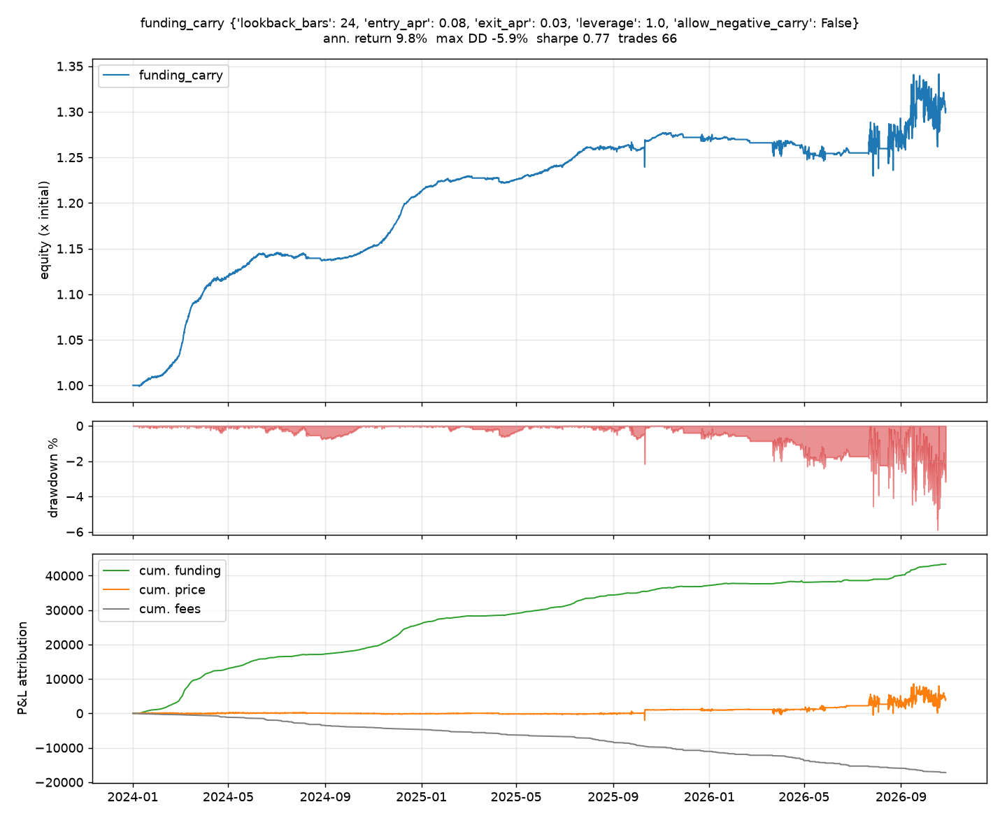

# Backtest results

All numbers below come from `scripts/compare_strategies.py` and `scripts/run_backtest.py`
on real dYdX v4 history. Nothing is tuned on the out-of-sample period; the walk-forward
table shows what happens when the funding regime changes.

## Setup

| | |
| --- | --- |
| Venue | dYdX v4 perpetuals (hourly funding settlements, oracle price attached to each settlement, unlimited candle history) |
| Markets | BTC, ETH, SOL, DOGE, AVAX, LINK |
| Period | 2024-01-01 to 2026-10-27 (1030 days) |
| Bars | 8h and 4h (hourly settlements summed per bar); 1h shown for contrast |
| Costs | perp taker 3.5 bp, hedge 5 bp, 1 bp slippage per leg, no borrow cost |
| Risk limits | 1.0x per leg, 2.0x gross (six markets share the budget), 15% drawdown kill switch, no stop loss |
| Capital | 100,000 simulated |

Mean funding over the period, annualised: BTC 9.4%, ETH 11.1%, SOL 7.9%, DOGE 10.1%,
AVAX 6.7%, LINK 9.1%. Spot returns over the same window: BTC +89%, ETH +2%, SOL -1%,
DOGE -13%, AVAX -77%, LINK -23%, so a long-only book had nothing to offer.

## Headline

Delta-neutral funding carry (`funding_carry`: short perp + long index while the 8-day
average funding is above the entry threshold, exit below 3% annualised), exact rebalance
to target every bar.

| Bars | Config | Annualised return | Max drawdown | Sharpe | Calmar | Funding yield p.a. | Fee drag p.a. | Trades | Time in market |
| --- | --- | --- | --- | --- | --- | --- | --- | --- | --- |
| 8h | entry 8%, exit 3%, lookback 24 bars | **9.8%** | **-5.9%** | 0.77 | 1.67 | 15.4% | 6.1% | 66 | 83% |
| 4h | entry 20%, exit 3%, lookback 24 bars | 7.9% | -6.3% | 0.60 | 1.25 | 14.3% | 4.7% | 46 | 57% |

P&L attribution of the 8h run on 100k: funding +43.3k, basis (price) +4.2k, fees -17.2k.



Benchmarks on the same panel:

| Bars | Strategy | Annualised return | Max drawdown | Sharpe |
| --- | --- | --- | --- | --- |
| 8h | `always_carry` (permanent short perp / long index) | 7.0% | -4.4% | 1.09 |
| 8h | buy and hold spot, equal weight | -3.8% | -16.6% | -0.34 |
| 8h | buy and hold perp, equal weight | -3.4% | -15.3% | -0.49 |
| 4h | `always_carry` | 5.8% | -5.6% | 0.75 |
| 4h | buy and hold spot | -3.9% | -17.1% | -0.65 |

Thresholded carry beats permanent carry on return (it sits out the negative-funding
stretches) but pays for the extra turnover with a slightly deeper drawdown; permanent
carry keeps the better Sharpe. Directional funding strategies (`funding_contrarian`,
`funding_momentum`) do not rank in the top 15 at any bar size.

Full rankings of all 41 configurations: [8h](results/comparison_dydx_8h.md),
[4h](results/comparison_dydx_4h.md), [1h](results/comparison_dydx_1h.md).

## Walk-forward

Same configurations, first 60% of the window in-sample, the rest out-of-sample.

| Bars | Config | Sample | Window | Annualised return | Max drawdown | Sharpe |
| --- | --- | --- | --- | --- | --- | --- |
| 8h | entry 8% / exit 3% | in-sample | 2024-01-01 to 2025-09-10 | 14.7% | -0.8% | 6.34 |
| 8h | entry 8% / exit 3% | out-of-sample | 2025-09-10 to 2026-10-27 | 2.7% | -5.9% | 0.23 |
| 4h | entry 20% / exit 3% | in-sample | 2024-01-01 to 2025-09-10 | 14.3% | -0.8% | 4.50 |
| 4h | entry 20% / exit 3% | out-of-sample | 2025-09-10 to 2026-10-27 | -1.1% | -6.3% | 0.06 |

The split is the honest part of this page. Funding was rich through the 2024 to mid-2025
bull market and has been thin or negative since; the carry trade earns what the market
pays, and the kill switch and hysteresis only limit how much of that it gives back.

## Sensitivity: rebalance discipline

`EngineConfig.rebalance_band` holds drifted weights instead of re-trimming them every bar.
A 0.1 band (trade only when a leg drifts 10% of equity from target) removes most of the
fee drag without changing entries or exits:

| Bars | Rebalance | Annualised return | Max drawdown | Sharpe | Fee drag p.a. |
| --- | --- | --- | --- | --- | --- |
| 8h | exact every bar | 9.8% | -5.9% | 0.77 | 6.1% |
| 8h | 0.1 band | 14.1% | -5.2% | 1.06 | 4.9% |
| 4h | exact every bar | 7.9% | -6.3% | 0.60 | 4.7% |
| 4h | 0.1 band | 11.9% | -5.3% | 0.86 | 3.3% |

The headline uses the conservative exact rebalance.

## Why 1h bars fail

The same carry config on hourly bars returns -2.3% with a -15.1% drawdown and trips the
kill switch. Two reasons, both instructive:

1. Fee drag: re-trimming six delta-neutral pairs every hour costs 15.7% a year against a
   12.8% funding yield. The band helps less here because turnover is dominated by the
   hourly entries and exits (234 trades).
2. The 2025-10-10/11 liquidation cascade: dYdX halted for several hours, candles are
   missing, and perp prints that do exist sit 35 to 42% below oracle on AVAX, DOGE and
   LINK. Hourly marks see every one of those prints; 4h and 8h closes see only the ones at
   bar boundaries.

## Data quality rule

During the halt the dYdX oracle price repeated the same value for seven consecutive
settlements. The dataset builder (`drop_frozen_oracle`) blanks any oracle value that
repeats the previous settlement exactly and, for bars with no usable oracle, marks the
hedge leg at the perp price (zero basis) instead of forward-filling a stale number. The 8h
panel is unchanged by this rule; the 1h panel loses a block of fictitious +-40% swings.

## Reproduce

```bash
python scripts/fetch_data.py --exchange dydx --symbols BTC ETH SOL DOGE AVAX LINK --interval 1h --start 2024-01-01
python scripts/compare_strategies.py --exchange dydx --symbols BTC ETH SOL DOGE AVAX LINK --interval 8h --start 2024-01-01
python scripts/run_backtest.py --exchange dydx --symbols BTC ETH SOL DOGE AVAX LINK --interval 8h --start 2024-01-01 \
    --strategy funding_carry --param entry_apr=0.08 --param exit_apr=0.03 --param lookback_bars=24 --plot
```

Add `--rebalance-band 0.1` for the sensitivity rows. Later runs extend the parquet cache
incrementally, so the end date moves and the numbers drift with it.

## Caveats

* Fills at bar closes with a flat cost model; no order book depth, no funding-rate impact.
* dYdX funding is lower and less positive than on the large centralised venues, so the
  same strategies on Binance or Bybit history would show a different (probably richer)
  funding yield.
* Max drawdown of a delta-neutral pair here is basis risk plus fees plus the time spent in
  negative funding; it is not protected by the kill switch at these levels (never fired on
  4h or 8h).
