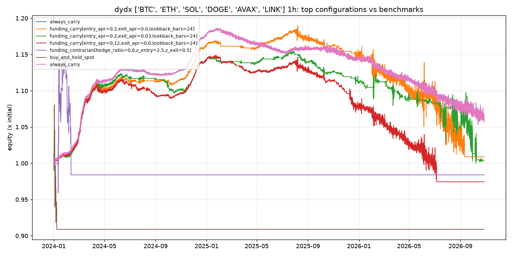

# dydx 1h comparison

Panel: **BTC, ETH, SOL, DOGE, AVAX, LINK**, 24726 bars of 1h, 2024-01-01 to 2026-10-27.
Costs: perp fee 3.5 bp, hedge fee 5.0 bp, slippage 1 bp per leg. Risk: gross leverage <= 2x, per-leg <= 1x, drawdown kill switch 15%.

## Top 15 of 41 configurations (by sharpe)

| label | annualized_return | max_drawdown | sharpe | calmar | funding_yield_annualized | fee_drag_annualized | time_in_market | n_trades |
|---|---|---|---|---|---|---|---|---|
| always_carry | 2.3% | -11.2% | 0.24 | 0.20 | 10.0% | 5.7% | 100.0% | 6 |
| funding_carry[entry_apr=0.2,exit_apr=0.0,lookback_bars=24] | 0.3% | -15.2% | 0.13 | 0.02 | 14.7% | 11.5% | 81.7% | 127 |
| funding_carry[entry_apr=0.2,exit_apr=0.03,lookback_bars=24] | 0.1% | -13.4% | 0.09 | 0.01 | 15.4% | 15.1% | 63.0% | 183 |
| funding_carry[entry_apr=0.12,exit_apr=0.0,lookback_bars=24] | -0.9% | -15.2% | 0.01 | -0.06 | 14.1% | 13.6% | 84.0% | 176 |
| funding_contrarian[hedge_ratio=0.0,z_entry=2.5,z_exit=0.5] | -0.6% | -15.7% | -0.03 | -0.04 | 0.4% | 0.8% | 1.7% | 41 |
| funding_carry[entry_apr=0.08,exit_apr=0.0,lookback_bars=24] | -1.4% | -15.2% | -0.07 | -0.09 | 13.7% | 14.3% | 82.4% | 201 |
| funding_contrarian[hedge_ratio=0.0,z_entry=1.5,z_exit=0.5] | -1.9% | -15.2% | -0.12 | -0.13 | 0.4% | 1.9% | 2.6% | 105 |
| cross_sectional_carry[min_apr=0.05,rebalance_bars=24,top_n=1] | -1.1% | -15.1% | -0.12 | -0.08 | 10.4% | 11.7% | 27.2% | 128 |
| cross_sectional_carry[min_apr=0.1,rebalance_bars=24,top_n=1] | -1.2% | -15.2% | -0.13 | -0.08 | 10.5% | 11.7% | 25.8% | 129 |
| funding_carry[entry_apr=0.05,exit_apr=0.0,lookback_bars=24] | -1.8% | -15.1% | -0.13 | -0.12 | 13.2% | 14.8% | 80.0% | 226 |
| funding_contrarian[hedge_ratio=0.0,z_entry=2.0,z_exit=0.5] | -2.3% | -15.2% | -0.21 | -0.15 | 0.4% | 1.2% | 2.1% | 67 |
| cross_sectional_carry[min_apr=0.05,rebalance_bars=6,top_n=1] | -2.4% | -15.1% | -0.29 | -0.16 | 9.9% | 13.2% | 24.1% | 155 |
| cross_sectional_carry[min_apr=0.1,rebalance_bars=6,top_n=1] | -2.5% | -15.3% | -0.31 | -0.16 | 9.9% | 13.5% | 23.2% | 159 |
| funding_carry[entry_apr=0.12,exit_apr=0.03,lookback_bars=24] | -2.3% | -15.9% | -0.31 | -0.15 | 13.7% | 16.9% | 64.4% | 233 |
| funding_carry[entry_apr=0.2,exit_apr=0.0,lookback_bars=6] | -2.4% | -15.1% | -0.33 | -0.16 | 12.7% | 16.5% | 58.7% | 265 |

## Benchmarks

| label | annualized_return | max_drawdown | sharpe | calmar | funding_yield_annualized | fee_drag_annualized | time_in_market | n_trades |
|---|---|---|---|---|---|---|---|---|
| always_carry | 2.3% | -11.2% | 0.24 | 0.20 | 10.0% | 5.7% | 100.0% | 6 |
| buy_and_hold_spot | -3.3% | -15.9% | -0.51 | -0.21 | 0.0% | 0.1% | 0.7% | 6 |
| buy_and_hold_perp | -3.2% | -15.3% | -0.53 | -0.21 | -0.2% | 0.0% | 0.5% | 6 |

## Walk-forward (first 60% in-sample, rest out-of-sample)

| label | sample | start | end | annualized_return | max_drawdown | sharpe |
|---|---|---|---|---|---|---|
| always_carry | in_sample | 2024-01-01 | 2025-09-10 | 9.1% | -3.0% | 1.27 |
| always_carry | out_of_sample | 2025-09-10 | 2026-10-27 | -7.1% | -9.6% | -0.32 |
| funding_carry[entry_apr=0.2,exit_apr=0.0,lookback_bars=24] | in_sample | 2024-01-01 | 2025-09-10 | 9.8% | -1.8% | 1.36 |
| funding_carry[entry_apr=0.2,exit_apr=0.0,lookback_bars=24] | out_of_sample | 2025-09-10 | 2026-10-27 | -13.5% | -15.2% | -0.19 |
| funding_carry[entry_apr=0.2,exit_apr=0.03,lookback_bars=24] | in_sample | 2024-01-01 | 2025-09-10 | 8.1% | -2.4% | 1.34 |
| funding_carry[entry_apr=0.2,exit_apr=0.03,lookback_bars=24] | out_of_sample | 2025-09-10 | 2026-10-27 | -10.7% | -12.3% | -0.31 |
| funding_carry[entry_apr=0.12,exit_apr=0.0,lookback_bars=24] | in_sample | 2024-01-01 | 2025-09-10 | 7.2% | -2.4% | 1.05 |
| funding_carry[entry_apr=0.12,exit_apr=0.0,lookback_bars=24] | out_of_sample | 2025-09-10 | 2026-10-27 | -13.6% | -15.4% | -0.51 |
| funding_contrarian[hedge_ratio=0.0,z_entry=2.5,z_exit=0.5] | in_sample | 2024-01-01 | 2025-09-10 | -0.9% | -15.7% | -0.03 |
| funding_contrarian[hedge_ratio=0.0,z_entry=2.5,z_exit=0.5] | out_of_sample | 2025-09-10 | 2026-10-27 | 17.0% | -15.1% | 0.57 |

