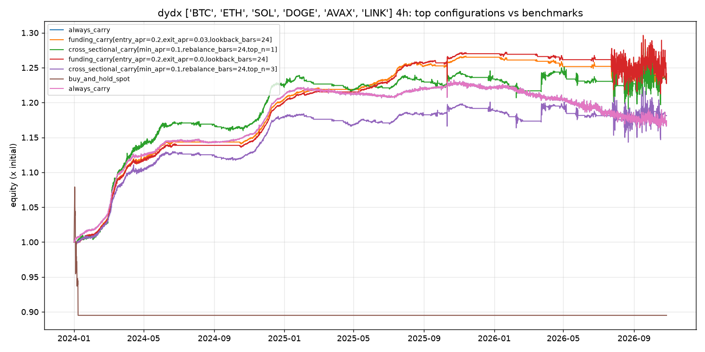

# dydx 4h comparison

Panel: **BTC, ETH, SOL, DOGE, AVAX, LINK**, 6182 bars of 4h, 2024-01-01 to 2026-10-27.
Costs: perp fee 3.5 bp, hedge fee 5.0 bp, slippage 1 bp per leg. Risk: gross leverage <= 2x, per-leg <= 1x, drawdown kill switch 15%.

## Top 15 of 41 configurations (by sharpe)

| label | annualized_return | max_drawdown | sharpe | calmar | funding_yield_annualized | fee_drag_annualized | time_in_market | n_trades |
|---|---|---|---|---|---|---|---|---|
| always_carry | 5.8% | -5.6% | 0.75 | 1.05 | 10.1% | 3.0% | 100.0% | 6 |
| funding_carry[entry_apr=0.2,exit_apr=0.03,lookback_bars=24] | 7.9% | -6.3% | 0.60 | 1.25 | 14.3% | 4.7% | 57.2% | 46 |
| cross_sectional_carry[min_apr=0.1,rebalance_bars=24,top_n=1] | 7.7% | -6.3% | 0.56 | 1.22 | 17.0% | 10.1% | 66.8% | 91 |
| funding_carry[entry_apr=0.2,exit_apr=0.0,lookback_bars=24] | 8.0% | -6.5% | 0.54 | 1.23 | 14.2% | 4.1% | 60.8% | 34 |
| cross_sectional_carry[min_apr=0.1,rebalance_bars=24,top_n=3] | 6.1% | -6.2% | 0.49 | 0.99 | 14.5% | 8.7% | 66.8% | 137 |
| cross_sectional_carry[min_apr=0.1,rebalance_bars=24,top_n=2] | 6.1% | -6.2% | 0.49 | 0.98 | 15.1% | 9.4% | 66.8% | 131 |
| funding_carry[entry_apr=0.08,exit_apr=0.03,lookback_bars=24] | 5.7% | -6.5% | 0.46 | 0.87 | 16.0% | 10.3% | 85.1% | 121 |
| funding_carry[entry_apr=0.12,exit_apr=0.03,lookback_bars=24] | 5.6% | -8.8% | 0.45 | 0.63 | 16.1% | 7.8% | 78.4% | 83 |
| funding_carry[entry_apr=0.05,exit_apr=0.0,lookback_bars=24] | 4.7% | -9.0% | 0.37 | 0.52 | 15.2% | 8.4% | 97.9% | 101 |
| cross_sectional_carry[min_apr=0.05,rebalance_bars=24,top_n=1] | 4.9% | -11.0% | 0.37 | 0.45 | 18.3% | 11.8% | 86.8% | 106 |
| cross_sectional_carry[min_apr=0.05,rebalance_bars=24,top_n=3] | 4.0% | -9.9% | 0.35 | 0.41 | 15.7% | 9.8% | 86.8% | 161 |
| cross_sectional_carry[min_apr=0.05,rebalance_bars=24,top_n=2] | 4.0% | -9.9% | 0.34 | 0.40 | 16.5% | 10.7% | 86.8% | 154 |
| funding_carry[entry_apr=0.08,exit_apr=0.0,lookback_bars=24] | 4.4% | -12.6% | 0.33 | 0.35 | 15.3% | 7.5% | 95.7% | 83 |
| funding_carry[entry_apr=0.12,exit_apr=0.0,lookback_bars=24] | 4.0% | -14.3% | 0.30 | 0.28 | 15.7% | 6.4% | 92.7% | 58 |
| funding_carry[entry_apr=0.2,exit_apr=0.03,lookback_bars=6] | 2.8% | -11.4% | 0.28 | 0.24 | 15.5% | 13.0% | 62.1% | 176 |

## Benchmarks

| label | annualized_return | max_drawdown | sharpe | calmar | funding_yield_annualized | fee_drag_annualized | time_in_market | n_trades |
|---|---|---|---|---|---|---|---|---|
| always_carry | 5.8% | -5.6% | 0.75 | 1.05 | 10.1% | 3.0% | 100.0% | 6 |
| buy_and_hold_perp | -3.2% | -15.3% | -0.57 | -0.21 | -0.3% | 0.0% | 0.7% | 6 |
| buy_and_hold_spot | -3.9% | -17.1% | -0.65 | -0.23 | 0.0% | 0.0% | 0.7% | 6 |

## Walk-forward (first 60% in-sample, rest out-of-sample)

| label | sample | start | end | annualized_return | max_drawdown | sharpe |
|---|---|---|---|---|---|---|
| always_carry | in_sample | 2024-01-01 | 2025-09-10 | 12.5% | -1.2% | 3.31 |
| always_carry | out_of_sample | 2025-09-10 | 2026-10-27 | -3.4% | -5.6% | -0.23 |
| funding_carry[entry_apr=0.2,exit_apr=0.03,lookback_bars=24] | in_sample | 2024-01-01 | 2025-09-10 | 14.3% | -0.8% | 4.50 |
| funding_carry[entry_apr=0.2,exit_apr=0.03,lookback_bars=24] | out_of_sample | 2025-09-10 | 2026-10-27 | -1.1% | -6.3% | 0.06 |
| cross_sectional_carry[min_apr=0.1,rebalance_bars=24,top_n=1] | in_sample | 2024-01-01 | 2025-09-10 | 13.0% | -1.8% | 2.39 |
| cross_sectional_carry[min_apr=0.1,rebalance_bars=24,top_n=1] | out_of_sample | 2025-09-10 | 2026-10-27 | -3.8% | -7.7% | -0.08 |
| funding_carry[entry_apr=0.2,exit_apr=0.0,lookback_bars=24] | in_sample | 2024-01-01 | 2025-09-10 | 14.6% | -0.5% | 4.95 |
| funding_carry[entry_apr=0.2,exit_apr=0.0,lookback_bars=24] | out_of_sample | 2025-09-10 | 2026-10-27 | -1.2% | -6.5% | 0.09 |
| cross_sectional_carry[min_apr=0.1,rebalance_bars=24,top_n=3] | in_sample | 2024-01-01 | 2025-09-10 | 10.4% | -1.5% | 2.88 |
| cross_sectional_carry[min_apr=0.1,rebalance_bars=24,top_n=3] | out_of_sample | 2025-09-10 | 2026-10-27 | -4.1% | -7.9% | -0.12 |

