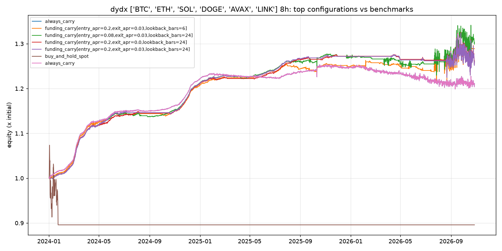

# dydx 8h comparison

Panel: **BTC, ETH, SOL, DOGE, AVAX, LINK**, 3091 bars of 8h, 2024-01-01 to 2026-10-27.
Costs: perp fee 3.5 bp, hedge fee 5.0 bp, slippage 1 bp per leg. Risk: gross leverage <= 2x, per-leg <= 1x, drawdown kill switch 15%.

## Top 15 of 41 configurations (by sharpe)

| label | annualized_return | max_drawdown | sharpe | calmar | funding_yield_annualized | fee_drag_annualized | time_in_market | n_trades |
|---|---|---|---|---|---|---|---|---|
| always_carry | 7.0% | -4.4% | 1.09 | 1.61 | 10.2% | 2.2% | 100.0% | 6 |
| funding_carry[entry_apr=0.2,exit_apr=0.03,lookback_bars=6] | 9.4% | -4.7% | 0.97 | 2.00 | 15.0% | 7.6% | 62.0% | 95 |
| funding_carry[entry_apr=0.08,exit_apr=0.03,lookback_bars=24] | 9.8% | -5.9% | 0.77 | 1.67 | 15.4% | 6.1% | 83.0% | 66 |
| funding_carry[entry_apr=0.2,exit_apr=0.0,lookback_bars=24] | 8.6% | -7.1% | 0.74 | 1.21 | 13.3% | 2.6% | 59.9% | 23 |
| funding_carry[entry_apr=0.2,exit_apr=0.03,lookback_bars=24] | 8.6% | -7.1% | 0.74 | 1.21 | 13.3% | 2.7% | 54.3% | 27 |
| cross_sectional_carry[min_apr=0.05,rebalance_bars=24,top_n=2] | 8.3% | -8.4% | 0.68 | 0.98 | 15.5% | 6.5% | 86.0% | 85 |
| funding_carry[entry_apr=0.05,exit_apr=0.0,lookback_bars=24] | 8.1% | -7.3% | 0.67 | 1.11 | 15.1% | 5.0% | 97.6% | 56 |
| cross_sectional_carry[min_apr=0.05,rebalance_bars=24,top_n=3] | 8.0% | -8.4% | 0.67 | 0.95 | 15.0% | 6.3% | 86.0% | 93 |
| funding_carry[entry_apr=0.12,exit_apr=0.03,lookback_bars=24] | 8.1% | -7.0% | 0.65 | 1.16 | 14.8% | 4.8% | 72.2% | 50 |
| funding_carry[entry_apr=0.08,exit_apr=0.0,lookback_bars=24] | 9.0% | -6.4% | 0.64 | 1.40 | 15.4% | 4.6% | 95.7% | 45 |
| cross_sectional_carry[min_apr=0.1,rebalance_bars=6,top_n=1] | 7.0% | -7.4% | 0.63 | 0.95 | 16.7% | 8.9% | 60.4% | 85 |
| funding_carry[entry_apr=0.12,exit_apr=0.0,lookback_bars=24] | 9.3% | -8.5% | 0.62 | 1.10 | 15.7% | 4.1% | 92.4% | 35 |
| funding_carry[entry_apr=0.12,exit_apr=0.03,lookback_bars=6] | 6.3% | -6.8% | 0.62 | 0.94 | 16.3% | 11.3% | 78.4% | 153 |
| cross_sectional_carry[min_apr=0.1,rebalance_bars=6,top_n=2] | 6.5% | -7.7% | 0.61 | 0.84 | 15.3% | 7.8% | 60.4% | 108 |
| cross_sectional_carry[min_apr=0.1,rebalance_bars=6,top_n=3] | 6.3% | -7.6% | 0.61 | 0.83 | 14.7% | 7.2% | 60.4% | 115 |

## Benchmarks

| label | annualized_return | max_drawdown | sharpe | calmar | funding_yield_annualized | fee_drag_annualized | time_in_market | n_trades |
|---|---|---|---|---|---|---|---|---|
| always_carry | 7.0% | -4.4% | 1.09 | 1.61 | 10.2% | 2.2% | 100.0% | 6 |
| buy_and_hold_spot | -3.8% | -16.6% | -0.34 | -0.23 | 0.0% | 0.1% | 2.1% | 6 |
| buy_and_hold_perp | -3.4% | -15.3% | -0.49 | -0.22 | -0.2% | 0.0% | 0.6% | 6 |

## Walk-forward (first 60% in-sample, rest out-of-sample)

| label | sample | start | end | annualized_return | max_drawdown | sharpe |
|---|---|---|---|---|---|---|
| always_carry | in_sample | 2024-01-01 | 2025-09-10 | 13.4% | -1.0% | 5.02 |
| always_carry | out_of_sample | 2025-09-10 | 2026-10-27 | -1.9% | -4.4% | -0.15 |
| funding_carry[entry_apr=0.2,exit_apr=0.03,lookback_bars=6] | in_sample | 2024-01-01 | 2025-09-10 | 13.9% | -1.0% | 5.79 |
| funding_carry[entry_apr=0.2,exit_apr=0.03,lookback_bars=6] | out_of_sample | 2025-09-10 | 2026-10-27 | 3.1% | -4.7% | 0.27 |
| funding_carry[entry_apr=0.08,exit_apr=0.03,lookback_bars=24] | in_sample | 2024-01-01 | 2025-09-10 | 14.7% | -0.8% | 6.34 |
| funding_carry[entry_apr=0.08,exit_apr=0.03,lookback_bars=24] | out_of_sample | 2025-09-10 | 2026-10-27 | 2.7% | -5.9% | 0.23 |
| funding_carry[entry_apr=0.2,exit_apr=0.0,lookback_bars=24] | in_sample | 2024-01-01 | 2025-09-10 | 15.0% | -0.5% | 6.91 |
| funding_carry[entry_apr=0.2,exit_apr=0.0,lookback_bars=24] | out_of_sample | 2025-09-10 | 2026-10-27 | -0.2% | -7.1% | 0.08 |
| funding_carry[entry_apr=0.2,exit_apr=0.03,lookback_bars=24] | in_sample | 2024-01-01 | 2025-09-10 | 15.1% | -0.4% | 7.09 |
| funding_carry[entry_apr=0.2,exit_apr=0.03,lookback_bars=24] | out_of_sample | 2025-09-10 | 2026-10-27 | -0.6% | -7.1% | 0.07 |

