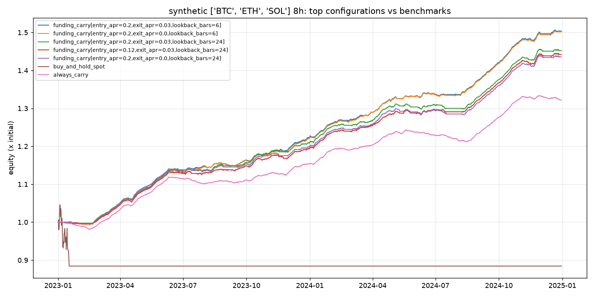

# synthetic 8h comparison

Panel: **BTC, ETH**, 2190 bars of 8h, 2023-01-01 to 2024-12-30.
Costs: perp fee 3.5 bp, hedge fee 5.0 bp, slippage 1 bp per leg. Risk: gross leverage <= 2x, per-leg <= 1x, drawdown kill switch 15%.

## Top 3 of 41 configurations (by sharpe)

| label | annualized_return | max_drawdown | sharpe | calmar | funding_yield_annualized | fee_drag_annualized | time_in_market | n_trades |
|---|---|---|---|---|---|---|---|---|
| funding_carry[entry_apr=0.2,exit_apr=0.03,lookback_bars=6] | 18.4% | -0.9% | 8.98 | 21.47 | 26.8% | 10.4% | 70.0% | 73 |
| funding_carry[entry_apr=0.2,exit_apr=0.0,lookback_bars=6] | 18.4% | -1.0% | 8.93 | 18.60 | 26.4% | 9.9% | 70.9% | 69 |
| funding_carry[entry_apr=0.12,exit_apr=0.03,lookback_bars=24] | 15.7% | -1.3% | 8.40 | 12.32 | 20.7% | 5.3% | 70.5% | 30 |

## Benchmarks

| label | annualized_return | max_drawdown | sharpe | calmar | funding_yield_annualized | fee_drag_annualized | time_in_market | n_trades |
|---|---|---|---|---|---|---|---|---|
| always_carry | 12.8% | -2.9% | 7.35 | 4.37 | 15.8% | 2.3% | 100.0% | 2 |
| buy_and_hold_perp | -6.9% | -15.2% | -0.62 | -0.46 | 0.8% | 0.1% | 5.2% | 2 |
| buy_and_hold_spot | -7.0% | -15.3% | -0.63 | -0.46 | 0.0% | 0.1% | 4.7% | 2 |

## Walk-forward (first 60% in-sample, rest out-of-sample)

| label | sample | start | end | annualized_return | max_drawdown | sharpe |
|---|---|---|---|---|---|---|
| funding_carry[entry_apr=0.2,exit_apr=0.03,lookback_bars=6] | in_sample | 2023-01-01 | 2024-03-13 | 18.7% | -0.9% | 8.77 |
| funding_carry[entry_apr=0.2,exit_apr=0.03,lookback_bars=6] | out_of_sample | 2024-03-14 | 2024-12-30 | 17.9% | -0.6% | 9.42 |
| funding_carry[entry_apr=0.2,exit_apr=0.0,lookback_bars=6] | in_sample | 2023-01-01 | 2024-03-13 | 18.6% | -1.0% | 8.68 |
| funding_carry[entry_apr=0.2,exit_apr=0.0,lookback_bars=6] | out_of_sample | 2024-03-14 | 2024-12-30 | 17.8% | -0.6% | 9.26 |
| funding_carry[entry_apr=0.12,exit_apr=0.03,lookback_bars=24] | in_sample | 2023-01-01 | 2024-03-13 | 16.8% | -0.8% | 8.96 |
| funding_carry[entry_apr=0.12,exit_apr=0.03,lookback_bars=24] | out_of_sample | 2024-03-14 | 2024-12-30 | 13.7% | -1.3% | 7.46 |
| funding_carry[entry_apr=0.12,exit_apr=0.03,lookback_bars=6] | in_sample | 2023-01-01 | 2024-03-13 | 17.9% | -0.9% | 8.31 |
| funding_carry[entry_apr=0.12,exit_apr=0.03,lookback_bars=6] | out_of_sample | 2024-03-14 | 2024-12-30 | 16.8% | -0.6% | 8.26 |
| funding_carry[entry_apr=0.12,exit_apr=0.0,lookback_bars=24] | in_sample | 2023-01-01 | 2024-03-13 | 16.4% | -0.8% | 8.83 |
| funding_carry[entry_apr=0.12,exit_apr=0.0,lookback_bars=24] | out_of_sample | 2024-03-14 | 2024-12-30 | 14.2% | -1.2% | 7.53 |

